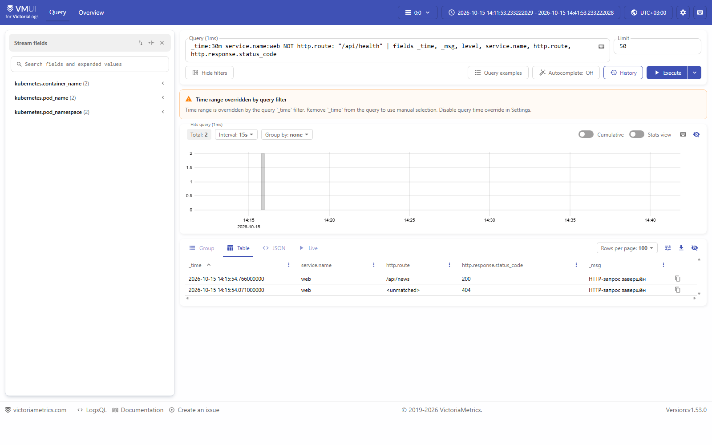
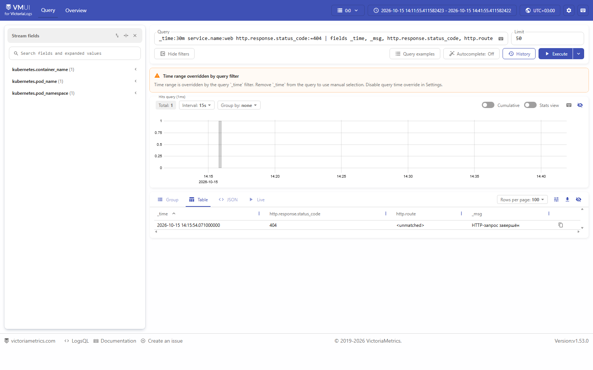
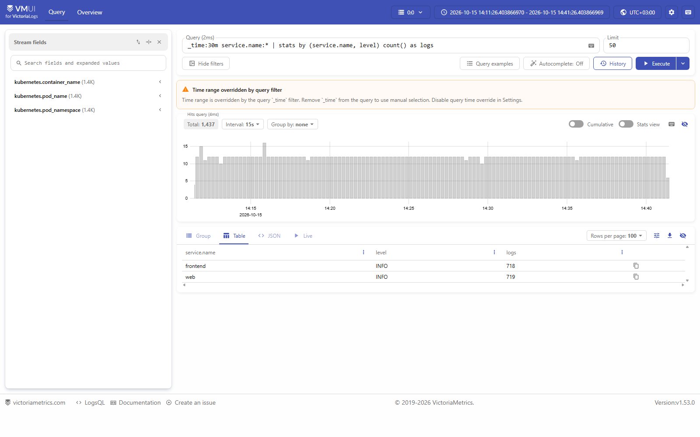
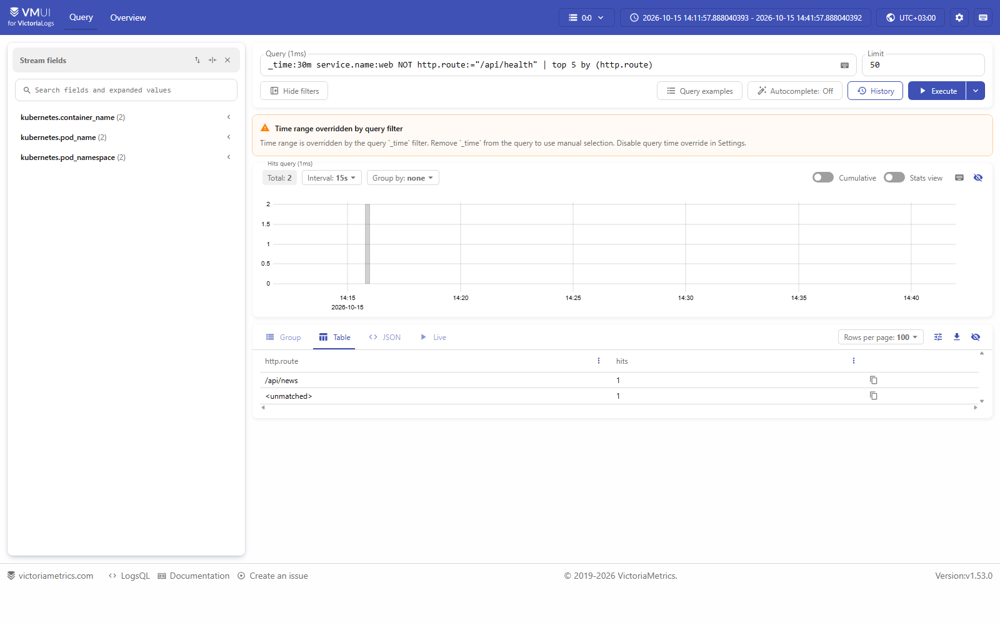
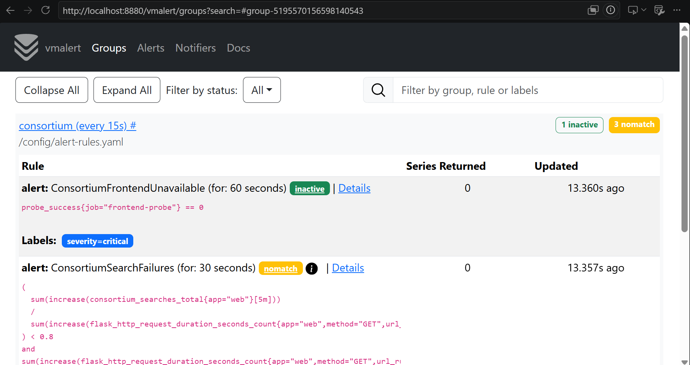
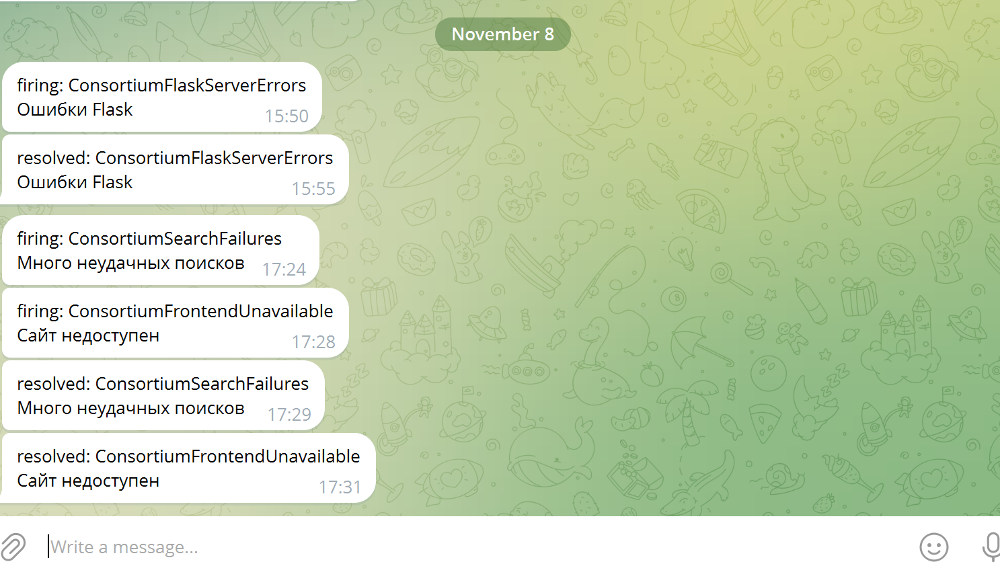
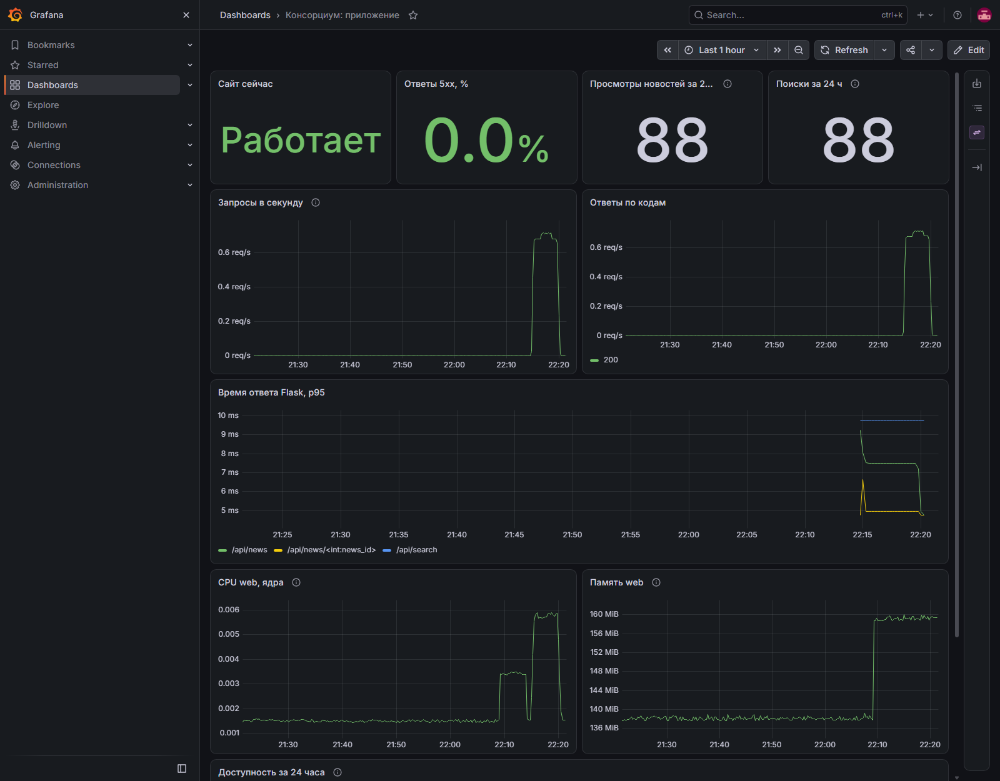
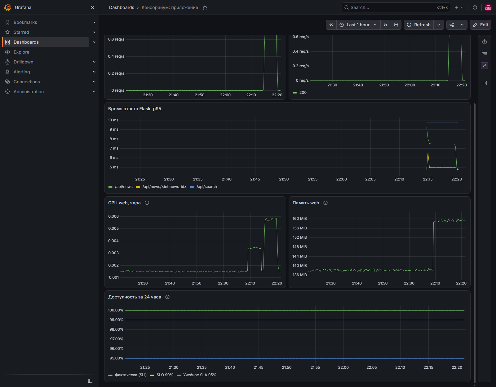
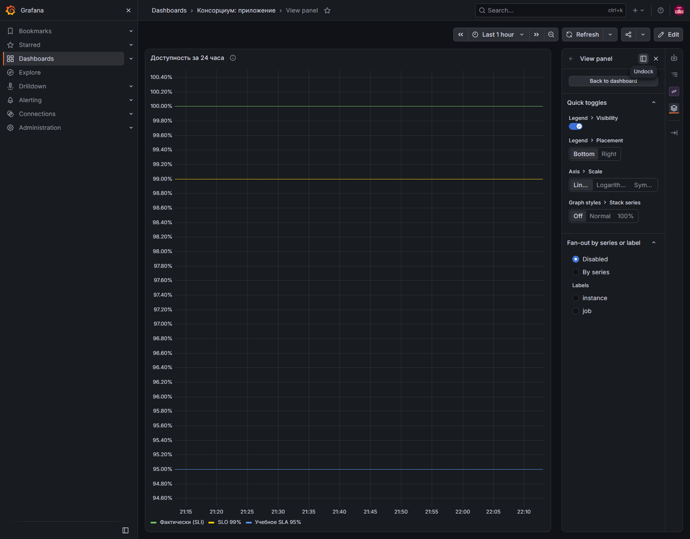
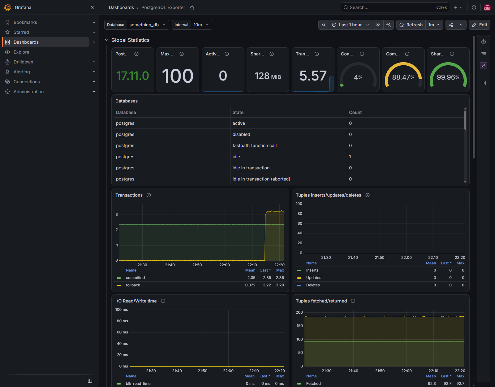

# Отчёт

## О проекте

На сайте консорциума можно читать новости, публикации, сведения о проектах, событиях и организациях. Посетитель может отправить обращение. Сотрудник добавляет, просматривает, меняет и удаляет записи через страницу управления.

## Технологии и данные

Страницы сайта сделаны на React. Сервер написан на Python с Flask и SQLAlchemy. Данные хранятся в PostgreSQL 17. Nginx отдаёт страницы и направляет запросы на сервер. Docker Compose запускает все части приложения.

Основные виды данных: авторы, журналы, новости, публикации, проекты, события, организации и обращения.

## 12 факторов

1. **Один исходный код.** Код сайта, сервера и файлы для запуска хранятся в одном проекте под управлением Git.
2. **Зависимости.** Нужные серверу пакеты и их версии перечислены в `Backend/requirements.txt`. Пакеты для страниц устанавливаются командой `npm ci` по файлу `package-lock.json`.
3. **Настройки.** Доступ к базе, почте и странице управления, а также правила доступа с других сайтов задаются переменными окружения. Файл с рабочими значениями не хранится в git.
4. **Внешние службы.** База данных и почтовый сервер работают отдельно от приложения. Данные для подключения к ним задаются в настройках.
5. **Сборка, выпуск и запуск.** Перед сборкой выбирается новый номер выпуска и создаётся папка для него. Если папка уже есть, сборка не начнётся. Затем создаются образы приложения и файл с настройками выпуска. Для запуска используются готовые образы.
6. **Работа без местного хранения данных.** Постоянные данные хранятся в PostgreSQL, а данные сеанса Flask - в браузере пользователя. Загрузка новых файлов отключена; имеющиеся файлы входят в образ. Если включить загрузку, файлам понадобится отдельное хранилище.
7. **Доступ по сети.** Приложение принимает запросы на порту контейнера. Порты для доступа с компьютера задаются в Docker Compose.
8. **Несколько копий сервера.** Можно запустить две копии сервера `web`. Автоматическая проверка запускает их и обращается к сайту.
9. **Запуск и остановка.** Для сервера заданы проверка доступности, перезапуск и время на остановку. Скорость запуска, завершение текущего запроса и доставку письма при сбое не проверял.
10. **Сходство условий работы.** При местной разработке и местном запуске используются одни и те же образы приложения и, по умолчанию, PostgreSQL 17. Тесты работают на Python 3.12 с отдельной PostgreSQL 17. Отдельных сред для предварительной проверки и работы с пользователями нет.
11. **Сообщения о работе.** Сервер выводит сообщения в журнал контейнера. Их можно посмотреть командой `docker compose logs`.
12. **Разовые служебные действия.** Таблицы в пустой базе создаются отдельной командой `flask --app run.py init-db` из того же образа, что и сервер.

## Задание 2. Запуск в Kubernetes

Я запустил приложение в minikube с одной рабочей нодой. Образы сервера и сайта собрал из `Backend/Dockerfile` и `my-app/Dockerfile`, затем загрузил их в minikube

### Что использовал

- **Deployment** запускает постгрес, сервер Flask и сайт с Nginx. Базу я оставил в одном экземпляре, число копий `web` и `frontend` можно менять командой `kubectl scale`.
- **Service** даёт каждому из этих компонентов постоянное имя в сети кластера: `db`, `web` и `frontend`.
- **PersistentVolumeClaim** `postgres-data` хранит данные PostgreSQL при пересоздании его пода.
- **Secret** `backend-env` хранит настройки и пароли. Я создаю его из `Backend/.env` перед запуском.
- **ConfigMap** `frontend-nginx` задаёт Nginx правила для сайта.
- **Job** `init-db` один раз создаёт таблицы в пустой базе до запуска сервера и сайта.

### Как части приложения общаются

В браузере я открываю сайт через `kubectl port-forward svc/frontend 3000:80`. Nginx отдаёт страницы React, а запросы к /api и /admin передаёт сервису web. Сервер Flask подключается к постгресу через сервис db: его имя указано в DB_HOST, а логин и пароль берутся из `backend-env`. Данные базы остаются на подключённом томе. При увеличении числа копий web или frontend их сервисы продолжают направлять запросы на работающие поды.

### Ссылка:

https://disk.yandex.ru/i/mKGaHRDMZAEgkw

К сожалению, запись недоступна из-за атаки на цод, а локально я ее удалил

## Задание 3. Логи в VictoriaLogs

Я запустил VictoriaLogs в том же minikube. Для неё выделил диск на 1 ГиБ, логи хранятся семь дней. Сборщик логов работает через DaemonSet: читает вывод контейнеров и отправляет записи в VictoriaLogs. Я выбрал его, потому что он умеет собирать логи Кубернетеса.

Flask и Nginx пишут логи в JSON, записи от web и frontend появились в VictoriaLogs.

### Запросы в vmui

Запрос 1. Записи web за последние 30 минут

```text
_time:30m service.name:web NOT http.route:="/api/health" | fields _time, _msg, level, service.name, http.route, http.response.status_code
```



Запрос 2. Записи с 404

```text
_time:30m service.name:web http.response.status_code:=404 | fields _time, _msg, http.response.status_code, http.route
```



Запрос 3. Число записей по сервисам и уровню логирования

```text
_time:30m service.name:* | stats by (service.name, level) count() as logs
```



Запрос 4. Пять адресов API с наибольшим числом записей

```text
_time:30m service.name:web NOT http.route:="/api/health" | top 5 by (http.route)
```



## Задание 4. Метрики в VictoriaMetrics

Я установил VictoriaMetrics в minikube через Helm. Она работает в monitoring и хранит метрики семь дней на диске объёмом 1 ГиБ.

Сервер Flask отдаёт метрики по адресу /metrics

Метрики запросов Flask собирает prometheus-flask-exporter, метрики базы - postgres-exporter. VictoriaMetrics находит их по аннотациям подов и собирает метрики.

Я добавил четыре счётчика для действий на сайте:

- `consortium_news_views_total` - сколько раз открыли существующую новость.
- `consortium_publication_views_total` - сколько раз открыли существующую публикацию.
- `consortium_searches_total` - сколько раз успешно выполнили поиск, в том числе без результатов.
- `consortium_contacts_saved_total` - сколько обращений сохранили в базе. Отправка письма на этот счётчик не влияет.

## Задание 5. Доступность сайта

Я использую 3 метрики: 

flask_http_request_duration_seconds_count считает запросы по маршрутам

consortium_news_views_total считает успешные открытия новостей

consortium_searches_total - успешные поиски

Ещё я добавил Blackbox Exporter, каждые 15 секунд VictoriaMetrics просит его открыть /api/health через frontend. Если Flask отвечает 204 и доступна база, probe_success равен 1, иначе 0.

Все показатели считаются за последние 24 часа. 

SLI - фактическая доля успешных действий, SLO - цель для этой доли.

1. Доступность сайта: 100 * успешные проверки / все проверки. SLO - не ниже 99%.

```text
100 * avg_over_time(probe_success{job="frontend-probe"}[24h])
```

чебное SLA по доступности сайта - не ниже 95% за 24 часа, по той же формуле

2. Успешные запросы к API: 100 * ответы 2xx и 3xx / все GET-запросы к API, кроме /api/health. SLO - не ниже 99%. Ответы 4xx здесь тоже считаются неуспешными попытками.

```text
100 * sum(increase(flask_http_request_duration_seconds_count{app="web",method="GET",url_rule=~"/api/.*",url_rule!="/api/health",status=~"2..|3.."}[24h])) / sum(increase(flask_http_request_duration_seconds_count{app="web",method="GET",url_rule=~"/api/.*",url_rule!="/api/health"}[24h]))
```

3. Открытие новости: 100 * успешные открытия конкретной новости / все попытки открыть конкретную новость. SLO - не ниже 99%. Несуществующая новость даёт 404 и уменьшает долю.

```text
100 * sum(increase(consortium_news_views_total{app="web"}[24h])) / sum(increase(flask_http_request_duration_seconds_count{app="web",method="GET",url_rule="/api/news/<int:news_id>"}[24h]))
```

4. Поиск: 100 * успешные поиски / все запросы к /api/search. SLO - не ниже 99%. Поиск без результатов успешен, пустой запрос получает 400 и уменьшает долю.

```text
100 * sum(increase(consortium_searches_total{app="web"}[24h])) / sum(increase(flask_http_request_duration_seconds_count{app="web",method="GET",url_rule="/api/search"}[24h]))
```

## Задание 6. Алерты

VictoriaMetrics хранит метрики. vmalert раз в 15 секунд проверяет правила из `k8s/victoria-metrics-alert-values.yaml`. Alertmanager отправляет уведомления в Telegram. Токен бота и номер чата хранятся в Kubernetes Secret.

Я выбрал четыре алерта:

- ConsortiumFrontendUnavailable: проверка сайта не проходит минуту. Это показывает, что сайт или база недоступны.
- ConsortiumSearchFailures: за пять минут было не меньше десяти попыток поиска, успешных меньше 80%. Так можно заметить ошибку в поиске, а если поиском никто не пользовался, алерт не срабатывает.
- ConsortiumFlaskServerErrors: за пять минут Flask вернул не меньше трёх ответов 5xx.
- ConsortiumFlaskNotFoundBurst: за пять минут Flask вернул не меньше пяти ответов 404. Возможно, это говорит о неверных ссылках  на сайте.

Пороги выбраны для проверки локально.

Я проверил алерт поиска, 12 пустых запросов к /api/search вернули 400, правило сработало, Alertmanager отправил уведомление без ошибок

Для проверки доступности я временно остановил web. Метрика probe_success стала равна 0, алерт сработал. После восстановления web метрика вернулась к 1, алерт перестал срабатывать.

Правила в vmalert:



Уведомления в Telegram:



## Задание 7. Дашборды в Grafana

Скринкаст: https://drive.google.com/file/d/1VSlFxZS2qLTIDAvgOE1LWGsxNqYfHXZc/view?usp=sharing

Я запустил Grafana в minikube, она читает метрики Flask, пробера, PostgreSQL exporter и контейнера web из VictoriaMetrics. Источник данных в Grafana - Prometheus. Мой дашборд сохранён в `k8s/grafana-app-dashboard.json`.

На дашборде я вывел доступность сайта, долю пятисоток, открытия новостей и поиски за 24 часа. Ниже видны запросы в секунду, ответы по кодам, время ответа Flask по маршрутам, CPU и память контейнера web.



CPU и память web берутся из метрик kubelet. Они показывают расход ресурсов всем контейнером, а не отдельным процессом Flask.



Отдельная панель показывает долю успешных проверок сайта в окне 24 часа: `100 * avg_over_time(probe_success{job="frontend-probe"}[24h])`. Рядом линии SLO 99% и SLA 95%. На снимке доля равна 100% среди собранных проверок.



Для базы я импортировал дашборд PostgreSQL Exporter и подключил его к VictoriaMetrics. На нём видны подключения, транзакции и другие показатели базы. Экспорт настроенного дашборда лежит в k8s/grafana-postgres-dashboard.json.


